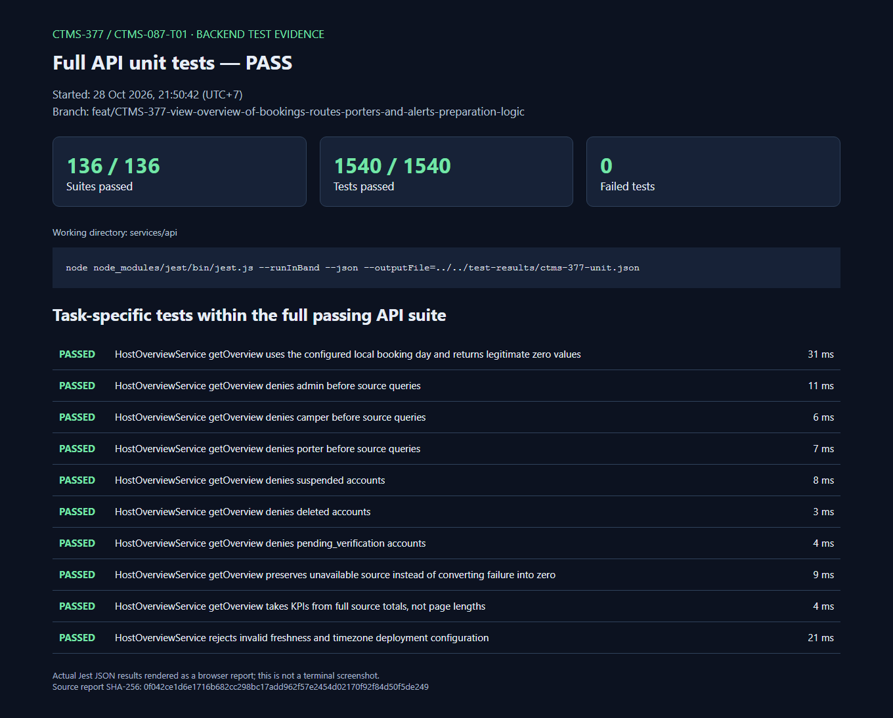
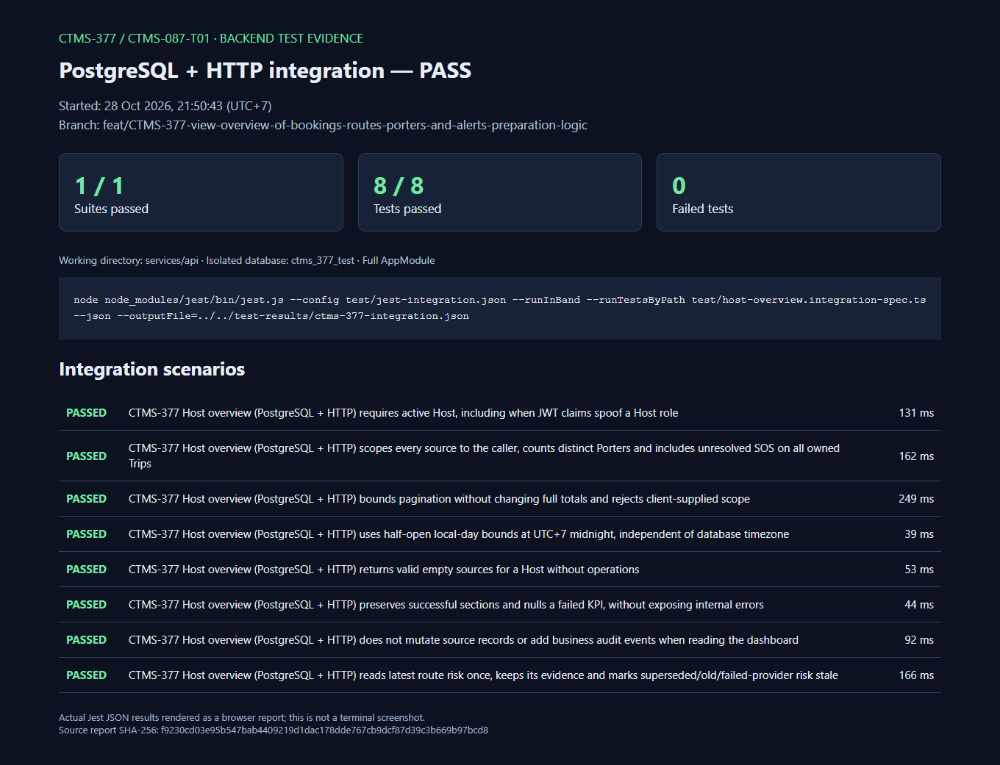

# CTMS-377 — Backend test evidence

Latest verification: 28 October 2026 (UTC+7), on the task branch.
Scope: backend logic only; no UI implementation or browser E2E claims.

## User-provided terminal screenshots — use these in the PR

The following seven original screenshots were supplied by the user after running
the commands locally. They are copied without image edits; source and destination
SHA-256 hashes were verified equal. These are the primary PR evidence images.

| Check | Screenshot |
| --- | --- |
| Task unit tests: 1 suite / 10 tests passed | [01-task-unit-tests.png](user-screenshots/01-task-unit-tests.png) |
| Full API unit tests: 136 suites / 1,540 tests passed | [02-full-api-unit-tests.png](user-screenshots/02-full-api-unit-tests.png) |
| PostgreSQL + HTTP integration: 1 suite / 8 tests passed | [03-postgres-http-integration.png](user-screenshots/03-postgres-http-integration.png) |
| TypeScript command completes without diagnostics | [04-typescript-check.png](user-screenshots/04-typescript-check.png) |
| Nest build command completes without diagnostics | [05-backend-build.png](user-screenshots/05-backend-build.png) |
| ESLint command completes without diagnostics | [06-eslint.png](user-screenshots/06-eslint.png) |
| Biome: 12 files checked, no fixes applied | [07-biome-check.png](user-screenshots/07-biome-check.png) |

The TypeScript/build/ESLint captures show the prompt returning without diagnostics;
they do not display an explicit numeric exit code. The report screenshots below
are retained as supplementary evidence from the earlier agent-run verification.

| Check | Result |
| --- | --- |
| Full API unit suite | 136/136 suites, 1,540/1,540 tests passed |
| Task integration, real PostgreSQL + HTTP, full AppModule | 1/1 suite, 8/8 tests passed |

These are browser screenshots of reports rendered directly from the actual Jest JSON
results, **not terminal screenshots**. No test outcomes were edited. Each image includes
the run timestamp, command, test names/results and the SHA-256 of the original report.
[`results.json`](results.json) contains a sanitized extract with the same totals and
task-specific assertion results. The original full reports remain in ignored
`test-results/ctms-377-unit.json` and `test-results/ctms-377-integration.json`.

## Full API unit test evidence

[Open report](unit-report.html)

## Task integration evidence

[Open report](integration-report.html)

The integration run uses the isolated `ctms_377_test` database, enforced by the existing
`_test` database guard. Auth/JWT/roles, source queries and HTTP are real. One explicitly
injected source exception verifies the partial-unavailability response; other source
queries still use PostgreSQL. No external weather-provider reliability is claimed.

For commands, API semantics, source limitations and other validation checks, see
[`ctms-377-host-overview.md`](../../features/ctms-377-host-overview.md).
