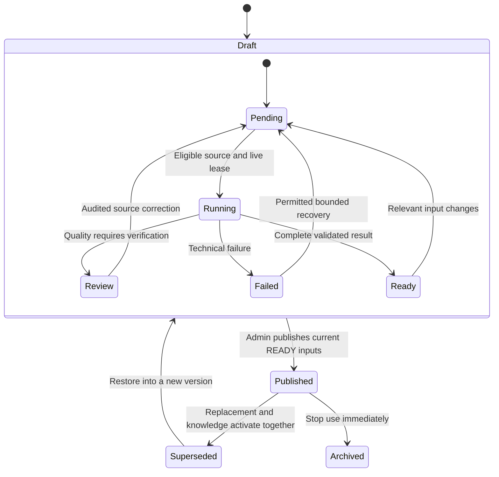
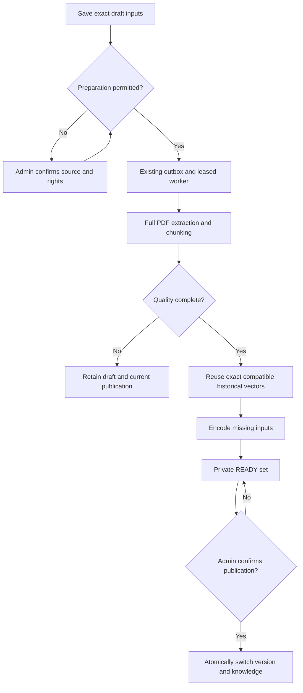

# Document versions and knowledge continuity

Applies to CTMS-050, CTMS-051, CTMS-220 and CTMS-068/069. This amendment implements pre-publication preparation using the existing document, ingestion, shared-vector and RAG boundaries. It supersedes the earlier publish-then-ingest workflow. Existing BR identifiers retain their owners; no new BR identifier is allocated.

## Existing and new behavior

| Capability | Behavior |
| --- | --- |
| Immutable source versions and increasing version numbers | Preserved. Historical versions are never made current again. |
| PDF parsing, quality gates and chunking | Preserved. Each new PDF version supplies all bytes to the existing parser and receives a complete independent extraction and chunk set. There is no incremental chunking between versions. Existing exact-region verification can resume its cached extraction. |
| Embedding storage and reuse | Preserved. The same document can reuse retained exact complete embedding inputs across its history, including shared vectors and compatible legacy inline vectors. The configuration hash, input SHA-256, exact input and vector integrity must match. Similarity is never a cache key. |
| Preparing a draft | New. An eligible private DRAFT is queued before publication. Source confirmation for preparation is separate from publication provenance. |
| Activating a prepared replacement | New. Publication, supersession, the current-version pointer, the active knowledge pointer, audit and outbox commit in one transaction. |
| Partial restoration | Existing CTMS-220 section operations, preview, explicit confirmation and provenance are retained; a no-op is compared by ordered content, not source IDs. |
| Full restoration | New explicit historical restore action creates a new draft containing the historical PDF. It records the source version and reason, resets rights and approvals, and uses the same preparation/publication workflow. |
| Emergency withdrawal | Preserved. Archive immediately removes retrieval eligibility, independently of replacement readiness. No automatic historical fallback. |

## Functional requirements

- Creation and relevant draft changes record durable `draft_preparation_requested` events for eligible inputs. Configured trusted sources can prepare immediately. Other uploaded sources require explicit Admin source confirmation through `prepare`; recording that confirmation does not set `published_by` or `published_at`.
- The preparation eligibility function accepts authorized DRAFTs or the current eligible publication. The retrieval eligibility function continues to require the current PUBLISHED version. Original-PDF offline distribution and translation retain their separate rights checks.
- Rights restrictions, explicit medical rejection and missing translation grants remain blocking. Compositions recheck adaptation grants and the generated PDF's medical approval on both preparation and publication. Restored historical approval is not copied into a new draft.
- `knowledge_revision` changes for title or locale changes. The PDF identity is immutable, so replacing bytes creates a new source version. Each set records `input_revision` and `source_title`, alongside the existing checksum, locale, version number and parser/model configuration. Non-ingestion metadata changes retain the prepared extraction; they may still require renewed source/rights confirmation.
- A changed input fences older jobs, leases and READY results. Checkpoint and completion recheck input identity. Configuration changes create a separate set using the existing configuration identity. An older READY set cannot authorize publication.
- READY on a draft means preparation completed, not publication or retrieval approval. Worker completion does not change either publication pointer for a draft.
- Publication requires both `expectedRevision` and `expectedDocumentRevision`. Under the document lock it revalidates current permission, source integrity, configuration, title, exact version/checksum/locale, quality, chunk count/order and vector references before supersession. The latest preparation generation must be READY; an older READY generation cannot bypass a newer pending review.
- Failure rolls back lifecycle, both pointers, audit and outbox together. Existing idempotent event delivery, exact-input embedding reuse, leases and capped technical recovery are retained. Source confirmation does not reset exhausted attempts or bypass quality review.
- A source explicitly outside RAG eligibility retains its existing document publication behavior; it receives no active RAG knowledge. UI and backend use the same distinction.

## Lifecycle and ingestion



The final restoration arrow creates a different version; it never changes the historical row back to DRAFT.



V1 remains current and retrievable throughout V2 preparation. At normal publication there is one committed snapshot with V1 active and the next with V2 active. An answer generated against an older snapshot still undergoes the existing final evidence revalidation; stale evidence is rejected rather than silently relabelled.

## API contracts

Routes remain under `/api/admin/survival-documents` and require an active Admin.

| Method and relative route | Contract |
| --- | --- |
| `POST /:id/versions/:versionId/prepare` | `expectedRevision`, `expectedDocumentRevision`, optional `confirmSource`, optional existing rights payload. Confirms eligible exact inputs and records preparation delivery. Remains DRAFT. Does not reset retry counters or activate knowledge. |
| `POST /:id/versions/:versionId/publish` | Requires the two expected revisions and all existing source/adaptation/medical checks. RAG-eligible publication rejects non-READY or stale preparation with HTTP 409 `SOURCE_KNOWLEDGE_NOT_READY`. |
| `POST /:id/versions/:versionId/restore` | Requires historical `expectedRevision`, `expectedDocumentRevision` and a 10–2000 character reason. Accepts an eligible SUPERSEDED version of the same document and returns a newly numbered DRAFT. |
| `GET /:id/versions/:versionId/chunk-sets` | Existing status contract, now includes input revision and source title. Ordered by input revision and generation. Count and completion time are authoritative stored values. |
| `GET /:id/versions/:versionId/content-verification` | Existing source-verification contract, scoped to current draft inputs; adds chunk count and completion time. No raw technical error text, model confidence or vectors are shown to Admin. |
| Existing editor plan/preview/confirm/commit routes | Preserved. Committing a confirmed composition creates a private version. Preparing and publishing remain separate actions. |

There is no draft retrieval endpoint and no manual chunk/vector editor. Source IDs remain internal API references; the UI presents version numbers, names, dates, explanations and recorded reasons.

## Restoration and duplicate protection

Partial example: V1 ABCD → V2 ABED → V3 ABEF. Replacing E with historical C through the existing editor produces a new V4 ABCF. The operation retains F and section-level source locations, requires adaptation grants for every included source, and creates a new PDF. The complete new document is extracted and chunked. Exact compatible inputs may reuse vectors from any retained version.

Full example: V1 ABCD → V2 ABED → restore V1 into V3 ABCD. V3 has its own source/version and chunk identities; retained C vectors can be reused. Rights and medical approval are not inherited. If C's retained vector has been cleaned up, it is regenerated.

BR-483's ordinary upload/import duplicate checks remain global. Only an internally authorized full restoration or a confirmed composition containing historical content can ignore matching SUPERSEDED rows of the same document. Current publications, other drafts, archived records and unrelated documents still participate in duplicate detection. An identical current publication cannot be recreated as a no-op. Partial-editor confirmation also rejects identical ordered content despite changed source identifiers.

## Database and deployment

Migration `1799000000000-PrepareDraftKnowledge.ts`:

- Adds draft input revision, preparation confirmation and restoration provenance to the existing version table.
- Adds input revision and captured title to existing chunk sets. Existing sets are backfilled with revision 1 and their source title; IDs, chunks, vectors, references and active publications are preserved.
- Extends the unique set key to `(document_version_id, config_hash, input_revision)`. Shared-vector keys are unchanged, allowing reuse between input revisions when the complete embedding input matches.
- Extends the existing outbox with preparation deliveries and separate idempotent indexes. A preparation event is unique per exact input revision; legacy lifecycle event uniqueness is preserved.
- Adds a same-document deferred restoration FK and immutable published preparation/restoration provenance. Whole-document deletion can still remove its own restoration history atomically; cross-document references remain protected.

No corpus re-ingestion or historical vector deletion is performed by this migration. Existing retention and orphan-vector cleanup remain unchanged. The preceding timeout recovery migration is retained from the earlier working tree.

Deploy compatible API/web code together with the migration. Downgrade is transactional and intentionally refuses restoration provenance, newer input revisions or multiple retained identities that cannot be represented by the older schema; no history is deleted to force rollback. A schema downgrade must be coordinated with the older application version. The API requires the cached/pinned `undici` dependency introduced by the preceding timeout fix.

## Verification matrix

| Scenarios | Automated coverage |
| --- | --- |
| T01–T04, T07–T09 | `knowledge-draft-lifecycle.spec.ts`, `document-publication.service.spec.ts`, `document-version-lifecycle.integration-spec.ts` |
| T05–T06, T10, T25 | Shared-transaction unit assertions plus guarded PostgreSQL rollback, competing publication and first-publication integration cases |
| T11 | Ordered ABCF restoration unit case; existing CTMS-220 composition HTTP integration |
| T12–T17, T23–T24 | Real repository/provider integration with deterministic extraction responses; assertions inspect passage-generation calls, independent chunk IDs and shared embedding references |
| T18–T20 | Publication-only policy units and guarded RAG repository integration, including replayed outbox deliveries after archive |
| T21 | Existing adaptation/specialist policy tests, rejected-medical draft tests and restored-version approval reset assertion |
| T22 | Migration down/up integration preserving active source, chunk IDs and embedding references |
| T26 | Repeated outbox consumption and a second worker attempt leave one set |
| Admin workflow | Existing web tests extended with pending/failure/stale-READY publication gates, explicit source confirmation and restoration reason; Playwright follows prepare → READY → explicit publish |

Integration and browser extraction fixtures do not evaluate real PDF parsing quality. Docling/OCR quality remains covered by the existing Python suites and source corpus evaluation. Actual execution results and environment blockers belong in the implementation report; coverage listed here does not claim a PostgreSQL or browser run succeeded.

```powershell
pnpm --filter @ctms/api test -- --runInBand knowledge-draft-lifecycle document-publication content-verification source-policy survival-source-reader knowledge-chunks rag-publication
pnpm --filter @ctms/api test:integration -- document-version-lifecycle.integration-spec.ts survival-documents.integration-spec.ts knowledge-chunks.integration-spec.ts
pnpm --filter @ctms/web test src/features/survival-documents/
pnpm --filter @ctms/web exec playwright test --config playwright.survival-documents.config.ts
```

Zero downtime here concerns document-level knowledge continuity during normal switching. It does not promise availability during infrastructure failure or intentional safety withdrawal.
