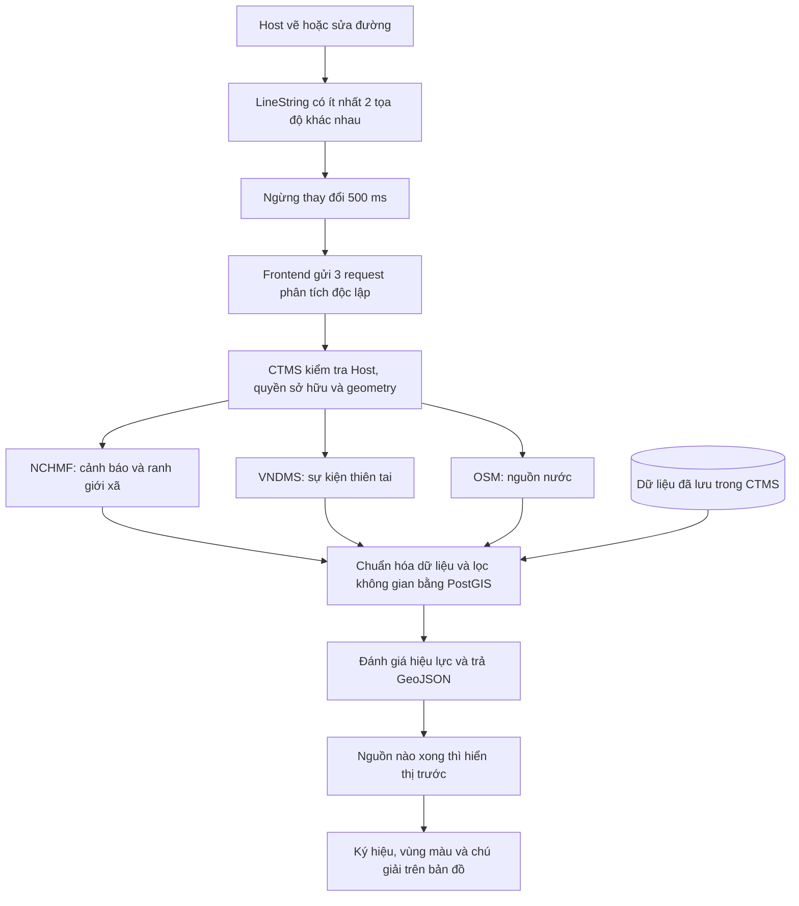

# Cách vận hành cảnh báo và nguồn nước quanh tuyến

Cập nhật: **31/10/2026**. Tài liệu mô tả mã nguồn hiện tại của luồng tạo, sửa và xem tuyến dành cho Host.

Khi Host vẽ tuyến, hệ thống tự gọi các nguồn dữ liệu bên ngoài, lọc theo đường đã vẽ rồi đưa vùng nguy hiểm, điểm nguy hiểm và nguồn nước lên bản đồ. Không cần lưu tuyến trước để phân tích.

## 1. Phạm vi của Route

Route chứa đường đi dùng lại được dưới dạng `LineString` và các thông tin cơ bản của tuyến. Host thêm hoặc kéo các đỉnh để điều chỉnh hình dạng đường.

Các đỉnh mang nhãn “Đỉnh 1”, “Đỉnh 2”…; luồng Route không gán chúng thành START, FINISH hay waypoint của chuyến đi. Tạo, sửa, gửi duyệt và duyệt tuyến không yêu cầu tạo checkpoint. Dữ liệu checkpoint cũ vẫn được giữ để tương thích; việc bố trí điểm đầu, điểm cuối và waypoint khi tạo Trip thuộc đợt refactor riêng.

Phân tích cảnh báo chạy độc lập với lưu tuyến. Khi một nguồn không truy cập được, Host vẫn có thể lưu tuyến nếu dữ liệu tuyến hợp lệ.

## 2. Luồng từ lúc vẽ đến lúc hiển thị



Chi tiết:

1. `RouteGeometryEditor` nhận geometry đang vẽ; `RouteSafetyPreview` nhận geometry của tuyến đã lưu.
2. Cả hai dùng `useRouteSafety`. Khi geometry thay đổi, kết quả của đường cũ bị ẩn ngay. Sau **500 ms** không thay đổi, đường mới được gửi đi.
3. Frontend gọi `POST /api/route-safety/analyze` ba lần với `source` lần lượt là `NCHMF`, `VNDMS` và `OSM`. Nhờ đó, nguồn nhanh không phải chờ nguồn chậm.
4. Backend xác thực tài khoản Host. Nếu truyền `routeId`, tuyến phải tồn tại và thuộc Host đó. Kiểm tra này và kiểm tra geometry diễn ra trước khi gọi nguồn bên ngoài.
5. Mỗi bộ thu thập gọi nguồn tương ứng và chuyển kết quả về cùng cấu trúc dữ liệu.
6. Backend đưa dữ liệu vừa thu thập cùng dữ liệu CTMS có quyền truy cập vào truy vấn PostGIS; sau đó tính hiệu lực, khoảng cách và mức nguy hiểm.
7. Frontend gộp các phản hồi đã hoàn tất theo `feature.id`, sắp xếp theo khoảng cách và giới hạn tối đa **500 feature**. Bản đồ cập nhật mỗi khi có thêm phản hồi.
8. Khi màn hình còn hoạt động, truy vấn tự làm mới mỗi **60 giây** theo cơ chế của TanStack Query. Nút làm mới trong chú giải cũng gọi lại cả ba nguồn.

Khóa truy vấn gồm Host, route, toàn bộ geometry và nguồn. Phản hồi của đường khác không được vẽ lên đường hiện tại. Trong lúc làm mới một nguồn, lớp dữ liệu cũ của nguồn đó được ẩn; các nguồn khác đã hoàn tất vẫn có thể hiển thị.

Backend không lưu bộ nhớ đệm các phản hồi cảnh báo NCHMF đã hoàn tất. Các request đồng thời có thể dùng chung một lần lấy danh sách cảnh báo đang chạy. Frontend có bộ nhớ truy vấn nhưng `staleTime = 0` và không dùng kết quả cũ đang được lấy lại để thể hiện như dữ liệu mới.

## 3. Dữ liệu đến từ đâu?

Các địa chỉ dưới đây là endpoint mà adapter trong mã nguồn đang sử dụng. Tài liệu này không ghi nhận một lần gọi trực tiếp mới hay số lượng dữ liệu thực tế tại thời điểm đọc.

| Nguồn | Dữ liệu sử dụng | Geometry sau chuẩn hóa |
| --- | --- | --- |
| NCHMF | Nguy cơ sạt lở và lũ quét theo xã | `Polygon` / `MultiPolygon` |
| VNDMS | Sự kiện thiên tai có vị trí đại diện | `Point` |
| OpenStreetMap | Mạch nước, điểm lấy nước, giếng, sông và suối | `Point` / `LineString` |
| CTMS | Dữ liệu lịch sử/tài nguyên đã nhập, vùng Host đã đánh dấu và sự cố thuộc Trip của Host | Theo geometry của bản ghi |

### NCHMF: cảnh báo hiện hành

Adapter gọi:

```http
POST https://luquetsatlo.nchmf.gov.vn/LayerMapBox/getDSCanhbaoSLLQ
Content-Type: application/x-www-form-urlencoded

date=yyyy-MM-dd HH:mm:ss&sogiodubao=6
```

`date` dùng giờ Việt Nam, làm tròn theo giờ. Nếu danh sách rỗng, adapter thử lần lượt hai giờ trước đó để xử lý độ trễ công bố. Dữ liệu vẫn phải còn hiệu lực; việc lùi giờ không cho phép dùng bản tin đã hết hạn.

Danh sách cảnh báo chứa mã xã và mức nguy cơ. Để có vùng vẽ lên bản đồ, adapter lấy thêm ranh giới từ WFS:

```text
https://geosllq.vndss.com/geoserversllq/ows
service=WFS
version=2.0.0
request=GetFeature
typeNames=cwrs_sllq:bgmap_commune
outputFormat=application/json
srsName=CRS:84
bbox=<khung bao tuyến đã mở rộng>,CRS:84
count=1000
```

Cảnh báo được ghép với ranh giới bằng `commune_id` và `gid`. Một xã có thể sinh hai feature riêng: sạt lở và lũ quét. Bản ghi trùng mã xã được gộp và giữ mức nguy cơ cao hơn.

**Polygon này là địa giới xã có cảnh báo**, không phải đường bao chính xác của một vụ sạt lở hoặc vùng ngập. Module hiện tại không tự suy ra ranh giới ngập từ nội dung bản tin trên trang tin NCHMF.

Hiệu lực dựa trên `thoigian` cộng **6 giờ**; `ngay_capnhat` là thời điểm cập nhật/phát hành của nguồn. Thiếu thời gian, thời gian tương lai, bản tin hết hạn hoặc dữ liệu sai định dạng sẽ không được coi là cảnh báo hiện hành.

### VNDMS: điểm sự kiện thiên tai

Adapter gọi đồng thời năm hiện tại theo giờ Việt Nam và năm trước:

```http
GET https://vndms.gov.vn/EventDisaster/Searching?year=YYYY&keyword=
```

`keyword` để trống để lấy danh sách sự kiện, sau đó mới lọc theo tuyến. Dữ liệu sử dụng gồm `lon`, `lat`, tên, địa bàn ảnh hưởng, thời gian và `da_ketthuc`.

- `lon`, `lat` trở thành `Point` đại diện của sự kiện; không tạo Polygon từ tên địa bàn.
- `da_ketthuc = true` trở thành dữ liệu `BASE_HISTORICAL`, trạng thái `RESOLVED`.
- Sự kiện chưa kết thúc mang loại `OFFICIAL_CURRENT`, nhưng còn phải qua kiểm tra độ mới để xác định có `ACTIVE` hay không.
- Bản ghi thiếu vị trí, thời gian hoặc trạng thái hợp lệ bị bỏ qua; nguồn có thể trả trạng thái `PARTIAL`.
- Cấp rủi ro của VNDMS được giữ trong mô tả. Adapter hiện để `severity = UNKNOWN`, không tự đổi thang rủi ro của VNDMS sang màu mức độ của CTMS.

Do đó, gọi API VNDMS vào hôm nay vẫn có thể nhận sự kiện cũ. “Vừa thu thập” và “đang nguy hiểm tại thời điểm hiện tại” là hai thông tin khác nhau.

### OSM: nguồn nước

Adapter chọn các đối tượng được gắn nhãn:

| Nhãn OSM | Ý nghĩa | Cách vẽ |
| --- | --- | --- |
| `natural=spring` | Mạch nước tự nhiên | Giọt nước tại điểm |
| `amenity=drinking_water` / `water_point` | Điểm cấp/lấy nước | Giọt nước tại điểm |
| `man_made=water_well` | Giếng nước | Giọt nước tại điểm |
| `waterway=stream` / `river` | Suối / sông | Đường màu xanh dương |

Không lấy `natural=water` để hiển thị hồ hoặc mặt nước dạng vùng. Backend và frontend cũng loại các RESOURCE dạng Polygon/MultiPolygon và các loại `water_water`, `water_surface`, `water_lake`, `water_reservoir` đã có trong dữ liệu cũ.

Với khung bao nhỏ, tối đa `0.01` độ vuông, bộ đọc OSM Map API chạy trước:

```http
GET https://api.openstreetmap.org/api/0.6/map.json?bbox=west,south,east,north
```

Nếu sau **400 ms** chưa xong, adapter khởi động thêm truy vấn Overpass tại `https://overpass.private.coffee/api/interpreter`. Phản hồi thành công đầu tiên được dùng, nhánh còn lại bị hủy. Khung bao lớn hơn dùng Overpass trực tiếp.

Geometry đường sông/suối lấy từ các tọa độ thực của OSM; không thay bằng một điểm trung tâm. Nguồn nước có `sourceType = RESOURCE`, chưa xác minh hiện có nước hay uống được và không tham gia tính mức nguy hiểm.

## 4. “Gần tuyến” được tính thế nào?

Mọi tọa độ theo thứ tự **[kinh độ, vĩ độ]**, hệ WGS84 / SRID 4326. PostGIS tính khoảng cách trên kiểu `geography` theo mét và dùng **toàn bộ LineString**, gồm tất cả đoạn đường.

Khung bao tuyến giúp giới hạn dữ liệu cần tải từ NCHMF/OSM. Đây chỉ là bước thu hẹp phạm vi; kết quả cuối còn phải qua phép lọc không gian trong database.

| Nhóm dữ liệu | Điều kiện đưa vào kết quả hiện tại |
| --- | --- |
| Dữ liệu vừa lấy từ NCHMF, VNDMS, OSM | `ST_DWithin(feature, route, proximity)` cho mọi geometry được chấp nhận |
| Dữ liệu nhập sẵn: Point | Cách tuyến không quá `proximity` |
| Dữ liệu nhập sẵn: LineString/Polygon/MultiPolygon | Có giao với tuyến bằng `ST_Intersects` |
| Vùng Host dạng Point | Thuộc route đang chọn và nằm trong khoảng `max(proximity, radius_m)` |
| Vùng Host dạng đường/vùng | Thuộc route đang chọn và có giao với tuyến |
| Sự cố Trip | Có vị trí, thuộc Trip của Host và cách tuyến không quá `proximity`; nếu có `routeId` thì thêm điều kiện cùng route |

`proximity` mặc định **300 m**, chỉnh được từ **1–5000 m**. Ví dụ, điểm sự kiện cách một đoạn ở giữa tuyến 200 m vẫn được chọn, dù cách hai đầu tuyến rất xa. Với nguồn live, một vùng cảnh báo cách tuyến 200 m cũng có thể xuất hiện dù tuyến chưa đi qua vùng.

Mỗi feature trả về `distanceMeters` và `intersects`. Kết quả ưu tiên đối tượng gần hơn; khi vượt 500 feature, `truncated = true`. Đây là giới hạn theo feature, không phải số xã hoặc số vụ thiên tai duy nhất.

## 5. Hiệu lực và mức nguy hiểm

Mỗi feature có hai thuộc tính độc lập:

- `severity`: `UNKNOWN`, `LOW`, `MEDIUM`, `HIGH`, `VERY_HIGH`.
- `lifecycleStatus`: đang có hiệu lực, đã cũ, hết hạn, đã kết thúc, lịch sử, chưa tới hiệu lực hoặc chưa rõ.

`safetyLifecycle` xử lý theo thứ tự:

1. Giữ `RESOLVED` nếu bản ghi đã được đánh dấu kết thúc.
2. Các bản ghi `BASE_HISTORICAL` còn lại thành `HISTORICAL`.
3. `validFrom` trong tương lai thành `SCHEDULED`; `validUntil` đã qua thành `EXPIRED`.
4. Vùng `HOST_DEFINED` hoặc bản ghi có `validUntil` còn hiệu lực được coi là `ACTIVE`.
5. Nếu không có hạn kết thúc, dùng `issuedAt`, hoặc `observedAt` khi thiếu `issuedAt`, để so tuổi dữ liệu. Mặc định là **360 phút** cho cảnh báo và **1440 phút** cho sự cố hiện trường.
6. Thiếu mốc thời gian thành `UNKNOWN`, mốc tương lai thành `SCHEDULED`, quá tuổi thành `STALE`; còn lại là `ACTIVE`.

`fetchedAt` chỉ là thời điểm nhận dữ liệu. Lấy lại dữ liệu cũ không làm mới hiệu lực.

`riskLevel` là mức cao nhất trong các feature **ACTIVE và không phải RESOURCE** được trả về. Không có bằng chứng đang có hiệu lực với mức độ xác định thì kết quả có thể là `UNKNOWN`. Đây không phải xác suất thiên tai hay kết luận toàn tuyến an toàn.

## 6. Bản đồ hiển thị gì?

| Ký hiệu/màu | Ý nghĩa |
| --- | --- |
| Tam giác có dấu chấm than | Điểm nguy hiểm |
| Giọt nước xanh dương | Điểm nguồn nước |
| Đường xanh dương | Sông/suối |
| Vùng/đường vàng | Nguy cơ trung bình |
| Vùng/đường cam | Nguy cơ cao |
| Vùng/đường đỏ | Nguy cơ rất cao |
| Màu xám | Chưa rõ mức độ |
| Màu nhạt | Dữ liệu nguy hiểm không ở trạng thái ACTIVE |

Mức `LOW` có màu vàng ô-liu; chú giải chỉ thêm mức này khi kết quả có feature LOW.

Điểm được vẽ bằng ký hiệu SVG tại tọa độ thật. Polygon/MultiPolygon và LineString được đưa vào nguồn GeoJSON `ctms-route-safety` của MapLibre, rồi cập nhật bằng `setData`.

Bấm vào điểm để xem thông tin ngắn; di chuột lên vùng/đường để xem popup. Popup giữ tên nguồn, mức độ, hiệu lực và mốc thời gian nếu có. Bấm ký hiệu, popup, nút làm mới hoặc điều khiển bản đồ không thêm đỉnh vào tuyến.

Chú giải nằm góc dưới bên phải, chỉ chứa ký hiệu, màu và nút làm mới. Tên NCHMF/VNDMS/OSM, dòng trạng thái nguồn và phần giải thích dài đã bỏ khỏi chú giải. Không hiển thị thanh thông tin nguồn ở góc bản đồ. Bản đồ dùng nền vệ tinh và đường màu cam, với nút zoom và “Xem toàn tuyến”.

Nếu bản đồ nền không tải được, chế độ tọa độ dự phòng vẫn vẽ đường, vùng và ký hiệu từ cùng kết quả phân tích. `VITE_MAPTILER_API_KEY` phục vụ bản đồ nền; nó không phải khóa lấy cảnh báo NCHMF/VNDMS/OSM.

Ở màn danh sách tuyến của Host, mỗi trang có tối đa **5 tuyến**. Phần tiêu đề và bộ lọc được giữ ở đầu màn hình khi cuộn. Các ô “Cảnh báo quanh tuyến” dùng chung kết quả với bản đồ: vùng trung bình/cao/rất cao, vị trí nguy hiểm và nguồn nước. Số đếm là feature trong dữ liệu đang có; một xã có hai loại cảnh báo có thể được đếm hai lần. Các ô nguy hiểm chỉ đếm ACTIVE, nên dữ liệu cũ có thể vẫn thấy trên bản đồ mà không tăng số đếm. Khi chưa có kết quả đầy đủ và chưa có feature, ô tương ứng có thể hiện “—”.

Dashboard không hiển thị nút “Xem toàn tuyến” trên bản đồ Trip và không có nút “Tạo tuyến trekking” trong thanh tác vụ. Host tạo tuyến từ màn quản lý tuyến.

### Vòng đời bản đồ và xử lý thiếu bộ nhớ đồ họa

`useRouteMapSurface` quản lý việc tạo và hủy MapLibre cho cả bản đồ vẽ và bản đồ xem trước. Đổi tuyến đang chọn cập nhật geometry trên cùng bản đồ, không đổi `key` để tạo WebGL context mới. `ResizeObserver` cập nhật kích thước khi bố cục thay đổi. Khối danh sách giãn cùng hàng với khối chi tiết; phần danh sách cuộn bên trong và phân trang nằm ở đáy.

Giới hạn hiện tại: tỉ lệ điểm ảnh tối đa 1.5, canvas tối đa 2048 × 2048, cache tối đa 64 tile mỗi nguồn và tối đa 8 yêu cầu ảnh đồng thời. Các tùy chọn này giảm lượng tài nguyên dùng cho nền vệ tinh; không bảo đảm mọi thiết bị đều có đủ bộ nhớ. Xem [MapOptions](https://maplibre.org/maplibre-gl-js/docs/API/type-aliases/MapOptions/) và [giới hạn yêu cầu ảnh](https://maplibre.org/maplibre-gl-js/docs/API/functions/setMaxParallelImageRequests/).

Lỗi một tile không hủy cả bản đồ. Khi mất WebGL context hoặc không tạo được renderer, hook hủy tài nguyên native và chuyển sang bản vẽ dự phòng. MapLibre 6 có thể trả về instance chưa có `painter` sau khi báo lỗi GPU ngay trong constructor; hook kiểm tra trường hợp này để tránh màn hình trắng chờ `load` mãi. Canvas native nằm trong một phần tử riêng để việc hủy bản đồ không xóa chú giải và các lớp giao diện React.

Log `GL_OUT_OF_MEMORY` rồi `GL_CONTEXT_LOST` cho biết cấp phát bộ nhớ đồ họa đã thất bại. Lỗi WebGL2 xuất hiện sau chuỗi này không đủ để kết luận trình duyệt vốn không hỗ trợ WebGL2. Cảnh báo WebSocket thuộc kết nối thông báo Trip, chạy riêng với bản đồ: callback thông báo được giữ qua ref, và việc mở socket được hoãn để lượt mount bị bỏ của StrictMode không mở rồi đóng kết nối ngay.

Kiểm tra cho lần chỉnh này: 35 kiểm tra tự động ở 6 file và 8 kịch bản Chrome đã qua, cùng kiểm tra TypeScript và Biome. Kịch bản trình duyệt dùng dữ liệu/API và style nền mô phỏng; bao gồm đổi nhiều tuyến mà giữ cùng canvas, căn đáy phân trang, vẽ/lưu/gửi duyệt và giả lập sự kiện mất context để kiểm tra bản vẽ dự phòng. Đây không phải phép đo bộ nhớ GPU với tile vệ tinh thật trên máy người dùng.

## 7. Dữ liệu có lưu vào database không?

**Luồng analyze không tự lưu dữ liệu live vừa gọi về vào bảng cảnh báo.** Các candidate được giữ trong bộ nhớ của request, truyền vào PostGIS để lọc rồi trả cho frontend.

| Dữ liệu | Nơi lưu / cách sử dụng |
| --- | --- |
| Geometry và thông tin tuyến | `trekking_routes` khi Host lưu tuyến |
| Cảnh báo/sự kiện/nguồn nước vừa thu thập | Trong request phân tích và bộ nhớ truy vấn của frontend; không tự ghi thành snapshot của route |
| Dữ liệu ngoài được Admin nhập có kiểm soát | `external_safety_features` |
| Bản ghi import bị từ chối | `safety_import_rejections` |
| Nhật ký import thành công | `audit_logs` |
| Vùng nguy hiểm Host đã đánh dấu | `route_danger_zones` |
| Sự cố hiện trường của Trip | `trip_incidents` |

`POST /api/route-safety/import` là luồng riêng, dành cho Admin, tối đa 1000 bản ghi/lần; nguồn phải nằm trong `ROUTE_SAFETY_APPROVED_SOURCES` và có `permissionReference`. Bản ghi hợp lệ được upsert; bản cũ hơn không ghi đè phiên bản mới hơn. Dữ liệu không hợp lệ được lưu để kiểm tra nguyên nhân.

Khi analyze, các bản ghi đã import loại `OFFICIAL_CURRENT` bị loại khỏi truy vấn. Nguồn live hỏng cũng không lấy bản import cũ thay thế để thể hiện như cảnh báo hiện hành. Dữ liệu lịch sử, tài nguyên và ngữ cảnh CTMS có quyền truy cập vẫn có thể tham gia.

Không có cron thu thập toàn quốc chạy nền trong module này. Việc lấy dữ liệu được kích hoạt khi frontend yêu cầu phân tích. Lưu route không đóng băng bộ cảnh báo tại thời điểm lưu; mở lại sẽ thực hiện kiểm tra mới.

## 8. API của CTMS và API key

Frontend gọi API của **CTMS**, cần JWT của tài khoản Host:

```http
POST /api/route-safety/analyze
Authorization: Bearer <JWT của Host>
Content-Type: application/json
```

Ví dụ body minh họa cho một nguồn:

```json
{
  "source": "NCHMF",
  "geometry": {
    "type": "LineString",
    "coordinates": [
      [108.178897, 16.062331],
      [108.168254, 16.056474]
    ]
  }
}
```

Có thể thêm `routeId` là UUID của tuyến thuộc Host, kể cả khi geometry gửi lên chứa thay đổi chưa lưu. Bỏ `routeId` để phân tích đường chưa lưu. Bỏ `source` để backend thu thập cả ba nguồn trong một request; cách này phải chờ các nhánh hoàn tất trước khi trả kết quả chung.

Geometry phải là WGS84 LineString hợp lệ, có ít nhất hai tọa độ khác nhau và tối đa **10000 đỉnh**.

Các trường phản hồi chính:

| Trường | Ý nghĩa |
| --- | --- |
| `features` | GeoJSON FeatureCollection đã lọc theo tuyến |
| `sources` | Trạng thái và mốc thời gian từng nguồn được yêu cầu |
| `liveSource` | Trạng thái NCHMF để tương thích với hợp đồng cũ, khi có yêu cầu NCHMF |
| `riskLevel` / `summary` | Mức nguy hiểm và số đếm theo bằng chứng trả về |
| `analyzedAt` | Thời điểm phân tích |
| `dataVersion` | Dấu nhận diện tính từ nội dung feature, không phải ID snapshot đã lưu |
| `proximityMeters` | Khoảng cách tra cứu thực tế |
| `truncated` | Có bị cắt do giới hạn số feature hay không |
| `coverage` | Hiện luôn là `PARTIAL`: không khẳng định dữ liệu bao phủ đầy đủ |

API trả **201** theo quy ước POST hiện tại. Lỗi xác thực, vai trò/quyền sở hữu, không tìm thấy tuyến và geometry không hợp lệ có thể trả 401, 403, 404, 400/422 tương ứng.

Các adapter NCHMF/VNDMS/OSM hiện gửi request tới endpoint công khai, không đính kèm API key hoặc tài khoản đăng nhập của nhà cung cấp. **API là địa chỉ và cách gọi để trao đổi dữ liệu; API key là một dạng thông tin xác thực mà một số API yêu cầu.** JWT đăng nhập CTMS và key bản đồ nền là các thông tin riêng.

## 9. Cấu hình và giá trị mặc định

`.env.example` là mẫu cấu hình để người triển khai biết các biến cần dùng. Nó không được đọc trực tiếp khi chạy ứng dụng. Khi API chạy từ `services/api`, `AppModule` cấu hình đọc `../../.env` và `.env`; cũng có thể cấp biến qua môi trường chạy. Sau khi đổi cấu hình, khởi động lại API.

| Biến môi trường | Mặc định | Tác dụng |
| --- | --- | --- |
| `ROUTE_SAFETY_PROXIMITY_METERS` | `300` | Khoảng cách lọc, 1–5000 m |
| `ROUTE_SAFETY_CURRENT_AGE_MINUTES` | `360` | Ngưỡng cũ khi cảnh báo không có hạn kết thúc |
| `ROUTE_SAFETY_INCIDENT_AGE_MINUTES` | `1440` | Ngưỡng cũ cho sự cố không có hạn kết thúc |
| `ROUTE_SAFETY_LIVE_ENABLED` | `true` | Cho phép lấy cảnh báo NCHMF |
| `ROUTE_SAFETY_LIVE_TIMEOUT_MS` | `12000` | Thời hạn thu thập NCHMF, 1000–30000 ms |
| `ROUTE_SAFETY_NCHMF_BASE_URL` | `https://luquetsatlo.nchmf.gov.vn` | Máy chủ cảnh báo |
| `ROUTE_SAFETY_NCHMF_BOUNDARIES_URL` | `https://geosllq.vndss.com/geoserversllq/ows` | WFS ranh giới xã |
| `ROUTE_SAFETY_VNDMS_ENABLED` | `true` | Cho phép lấy sự kiện VNDMS |
| `ROUTE_SAFETY_VNDMS_BASE_URL` | `https://vndms.gov.vn` | Máy chủ sự kiện |
| `ROUTE_SAFETY_WATER_ENABLED` | `true` | Cho phép lấy nguồn nước |
| `ROUTE_SAFETY_OVERPASS_URL` | `https://overpass.private.coffee/api/interpreter` | Overpass |
| `ROUTE_SAFETY_OSM_MAP_URL` | `https://api.openstreetmap.org/api/0.6/map.json` | OSM Map API |
| `ROUTE_SAFETY_CONTEXT_TIMEOUT_MS` | `20000` | Thời hạn thu thập VNDMS/OSM, 1000–30000 ms |
| `ROUTE_SAFETY_APPROVED_SOURCES` | Rỗng | Danh sách nguồn được Admin import, phân cách bằng dấu phẩy |

Các cờ bật/tắt chỉ tắt khi giá trị là chuỗi `false`. Danh sách nguồn được import để trống không tắt bộ thu thập live.

Việc import `SAFETY_DEFAULT_PROXIMITY_METERS` hay các hằng số khác từ file policy chỉ là **import mã TypeScript**. Khi chạy, service đọc cấu hình bằng `ConfigService` trước; hằng số dùng làm giá trị dự phòng nếu biến số bị thiếu, không hợp lệ hoặc ngoài khoảng cho phép. Vì vậy, vẫn cần `.env.example` để mô tả cách tùy chỉnh mà không sửa code.

Các giới hạn như 500 feature, 10000 đỉnh, debounce 500 ms và nhịp làm mới 60 giây hiện là hằng số trong code, không phải tất cả đều có biến môi trường.

## 10. Khi không thấy dữ liệu trên bản đồ

Không có ký hiệu có thể do tuyến chưa đủ hai tọa độ khác nhau, đang chờ phản hồi, không có feature phù hợp trong phạm vi, nguồn lỗi, dữ liệu bị loại vì thiếu thông tin hoặc dữ liệu không còn hiệu lực để tính số đếm.

Trạng thái nguồn nằm trong `sources` của phản hồi:

| Trạng thái | Cách hiểu |
| --- | --- |
| `LOADING` | Frontend đang chờ request; không phải trạng thái backend trả |
| `LIVE` | Bộ thu thập lấy được dữ liệu hợp lệ; không đồng nghĩa có cảnh báo gần route |
| `EMPTY` | Không thu được candidate từ nguồn theo truy vấn hiện tại |
| `PARTIAL` | Chỉ lấy được một phần hoặc gặp giới hạn/bản ghi bị bỏ qua |
| `UNAVAILABLE` | Không lấy được dữ liệu nguồn |
| `DISABLED` | Nguồn bị tắt bằng cấu hình |

Lỗi upstream thường được adapter chuyển thành `UNAVAILABLE` với danh sách candidate rỗng; CTMS vẫn có thể trả HTTP 201. Vì vậy cần đọc `sources`, không chỉ nhìn mã HTTP hoặc số feature.

Theo giao diện hiện tại, trạng thái từng nguồn không hiện thành đoạn chú thích trên bản đồ. Vòng xoay trong nút làm mới thể hiện đang gọi; nút bị vô hiệu khi tuyến chưa hợp lệ hoặc đang tải. Tooltip lỗi request phân tích chỉ xuất hiện khi các request đều lỗi; một adapter trả `UNAVAILABLE` trong phản hồi thành công không nhất thiết làm tooltip này hiện lỗi.

Một số giới hạn cần xét khi kiểm tra:

- NCHMF giới hạn danh sách 20000 dòng, tối đa 1000 ranh giới/lần; phản hồi thiếu ranh giới được đánh dấu PARTIAL.
- OSM xử lý tối đa 1000 đối tượng/lần; khung bao rộng hơn 1 độ theo một trong hai trục trả PARTIAL và không thu thập nguồn nước.
- HTTP reader giới hạn mỗi phản hồi 16 MiB. Mạng, timeout, lỗi định dạng hoặc thay đổi endpoint đều có thể làm nguồn unavailable.
- Không có Polygon ngập chính xác từ adapter hiện tại; không suy rộng Point đại diện VNDMS thành vùng ảnh hưởng.
- Không có dữ liệu phù hợp không phải bằng chứng tuyến an toàn; nguồn nước được đánh dấu không bảo đảm còn nước hay uống được.

Có thể dùng Developer Tools → Network để xem ba request `route-safety/analyze`, `sources` và `features`. Nếu request không được gửi, kiểm tra geometry và đăng nhập Host trước. Nếu tất cả đều lỗi do database, kiểm tra PostgreSQL/PostGIS và các migration; module vẫn cần database để lọc dù dữ liệu được lấy trực tiếp.

Script kiểm tra riêng các bộ thu thập, chạy từ `services/api`:

```powershell
node -r ts-node/register/transpile-only scripts/check-route-safety-live.ts
```

Script không ghi database và báo số candidate **trước khi lọc PostGIS theo tuyến**. Không dùng con số đó như số điểm/vùng sẽ hiện trên bản đồ. Script dùng `dotenv/config`; nó không khởi tạo toàn bộ cơ chế đọc env của `AppModule`.

## 11. Các file chính để đọc hoặc chỉnh sửa

Đường dẫn dưới đây tính từ thư mục gốc repository.

| Trách nhiệm | File |
| --- | --- |
| Kích hoạt phân tích, debounce và làm mới | [useRouteSafety.ts](../../apps/web/src/features/route-safety/hooks/useRouteSafety.ts) |
| Gộp phản hồi và tính số đếm/mức nguy hiểm phía web | [combine-safety-queries.ts](../../apps/web/src/features/route-safety/utils/combine-safety-queries.ts) |
| Giao diện vẽ tuyến | [RouteGeometryEditor.tsx](../../apps/web/src/features/trekking-routes/components/RouteGeometryEditor.tsx) |
| Vòng đời bản đồ, giới hạn tài nguyên và chế độ dự phòng | [useRouteMapSurface.ts](../../apps/web/src/features/trekking-routes/hooks/useRouteMapSurface.ts) |
| Cập nhật đường, vùng và marker trên bản đồ xem trước | [useRoutePreviewMap.ts](../../apps/web/src/features/trekking-routes/hooks/useRoutePreviewMap.ts) |
| Xem tuyến đã lưu cùng cảnh báo | [RouteSafetyPreview.tsx](../../apps/web/src/features/trekking-routes/components/RouteSafetyPreview.tsx) |
| Chú giải trong bản đồ | [RouteSafetyLegend.tsx](../../apps/web/src/features/route-safety/components/RouteSafetyLegend.tsx) |
| Ký hiệu, màu và popup | [map-symbols.ts](../../apps/web/src/features/route-safety/map-symbols.ts), [useSafetyMapSymbols.ts](../../apps/web/src/features/route-safety/hooks/useSafetyMapSymbols.ts), [safety-popup.ts](../../apps/web/src/features/route-safety/safety-popup.ts) |
| Lớp GeoJSON trên MapLibre | [useSafetyMapLayers.ts](../../apps/web/src/features/route-safety/hooks/useSafetyMapLayers.ts) |
| API, kiểm tra quyền và điều phối phân tích | [route-safety.controller.ts](../../services/api/src/modules/route-safety/route-safety.controller.ts), [route-safety.service.ts](../../services/api/src/modules/route-safety/route-safety.service.ts) |
| Truy vấn không gian và phạm vi dữ liệu CTMS | [route-safety.repository.ts](../../services/api/src/modules/route-safety/route-safety.repository.ts) |
| Lấy cảnh báo NCHMF và ranh giới xã | [nchmf-safety.service.ts](../../services/api/src/modules/route-safety/nchmf-safety.service.ts) |
| Lấy sự kiện VNDMS | [vndms-safety.service.ts](../../services/api/src/modules/route-safety/vndms-safety.service.ts), [vndms-event.ts](../../services/api/src/modules/route-safety/vndms-event.ts) |
| Lấy và chuẩn hóa nguồn nước | [osm-water.service.ts](../../services/api/src/modules/route-safety/osm-water.service.ts), [osm-water-query.ts](../../services/api/src/modules/route-safety/osm-water-query.ts), [osm-water.ts](../../services/api/src/modules/route-safety/osm-water.ts) |
| Mặc định và logic hiệu lực | [route-safety.policy.ts](../../services/api/src/modules/route-safety/route-safety.policy.ts) |
| Mẫu biến môi trường | [.env.example](../../.env.example) |

Xem thêm [ghi chép kỹ thuật và lịch sử triển khai](route-safety-v2.md) và [quy tắc nghiệp vụ Route Safety](../business-rules/route-safety-v2.md).

