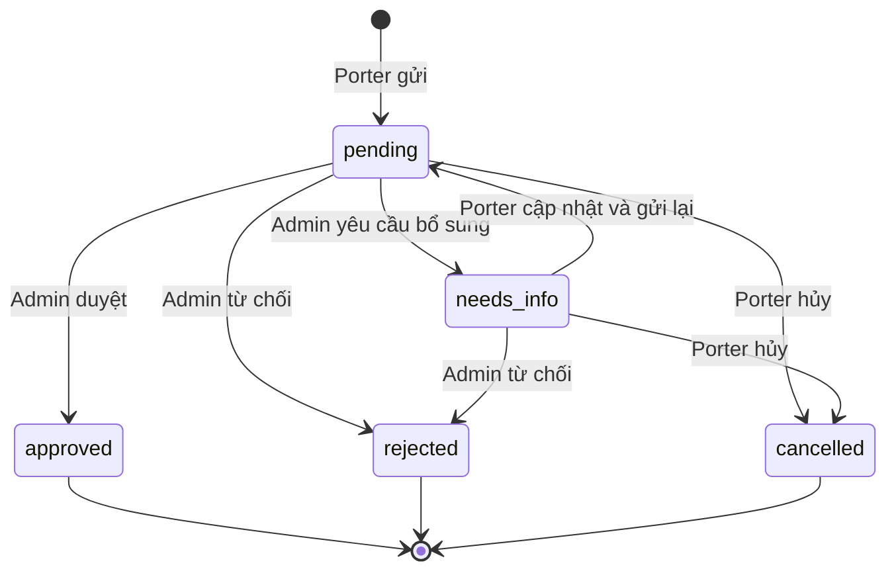

# CTMS-138 — Yêu cầu nâng cấp và xét cấp Porter theo tuyến

Phần bổ sung được thống nhất với người dùng ngày 28/10/2026 cho CTMS-43/CTMS-138.

## Phạm vi và mô hình

- Cấp thuộc cặp `(porter_id, route_id)` trong `porter_route_qualifications`: learning < proficient < expert.
- Không có bản ghi nghĩa là chưa khai báo, không tự suy ra learning. Porter khai báo tuyến trước khi yêu cầu nâng cấp.
- `verified_by` và `verified_at` đã có sẵn, cùng có giá trị nghĩa là đã xác minh. Không đặt lại trạng thái dữ liệu cũ khi migrate.
- Tái sử dụng `porter_level_policies`: tiêu chí chung theo cấp, Admin tự nhập, không seed ngưỡng hoặc tự chấm đạt/chưa đạt.
- Một Admin quyết định, áp dụng ngay, cho nhảy cấp, không có ngày hiệu lực tùy chọn hoặc thời gian chờ cố định.

## Trạng thái

`pending` và `needs_info` đều là yêu cầu mở. Partial unique index trên `(porter_id, route_id)` chặn gửi trùng.
Chỉ sửa lý do/minh chứng khi `needs_info`. Gửi lại phải thay đổi lý do, hồ sơ hoặc nội dung minh chứng;
tải lại cùng nội dung file không tính là thay đổi. Xin lại cùng cấp sau từ chối cũng cần thay đổi nội dung.

## Quyền và toàn vẹn

- Porter chỉ tạo, đọc, bổ sung, tải file và hủy yêu cầu của mình. Cấp đích phải cao hơn cấp đang lưu, kể cả khi đó là cấp tự khai.
- Admin chỉ duyệt đúng cấp đã xin. Duyệt, từ chối, yêu cầu bổ sung và xét cấp trực tiếp luôn cần lý do.
- Không tự xét cấp của mình, kể cả tài khoản có cả vai trò Admin và Porter.
- Hồ sơ chứng chỉ phải approved trước khi duyệt hoặc công nhận cấp.
- Admin xét cấp trực tiếp để nâng/hạ/công nhận mức tự khai. Cùng cấp đã xác minh là thao tác không thay đổi và bị từ chối.
- Có yêu cầu mở thì chặn xét cấp trực tiếp và sửa cấp/số lần dẫn tuyến qua luồng khai báo. Lỗi `OPEN_REQUEST_EXISTS` kèm requestId để UI dẫn tới yêu cầu.
- Tất cả thao tác ghi dùng thứ tự khóa Route → Porter → profile/skills/verification → qualification → request.
  Khi duyệt kiểm tra lại trạng thái, cấp hiện tại, xác minh và phiên bản yêu cầu/qualification/tiêu chí/hash hồ sơ.
- Composite FK bảo đảm identity sao chép trong yêu cầu khớp qualification. CHECK ở DB bảo đảm target cao hơn current.

## Bảng và lưu vết

- `porter_level_requests`: qualification, Porter, tuyến, cấp/trạng thái xác minh lúc gửi, cấp đích, lý do, trạng thái, version, hash lần gửi và quyết định Admin.
- `porter_level_request_events`: mỗi chuyển trạng thái/thay đổi minh chứng có actor/time/reason và bản chụp nội dung/files.
- `porter_level_request_evidence`: file_ref UUID, tên, MIME, size, SHA-256, thời điểm tải và removed_at. Xóa mềm không xóa file gốc.
- Mở rộng `porter_level_decisions` dùng chung: source direct/request, requestId, action, from/to verification, policy/dossier/evidence snapshots, lý do Porter.
  Không sửa lịch sử qua API; duyệt yêu cầu chỉ có một quyết định cho mỗi requestId.
- `porter_level_notification_outbox` ghi cùng transaction với quyết định; worker chuyển sang inbox `porter_level_notifications` sau commit.
  Retry qua outbox không tạo thông báo trùng. Giai đoạn này chỉ thông báo trong app, không gửi email/SMS.

Minh chứng tùy chọn khi gửi, tối đa 5 file đang dùng/yêu cầu, 5 MB/file, PDF/PNG/JPEG kiểm tra chữ ký file.
Kho riêng `.private-porter-level-evidence` nằm ngoài đường dẫn public uploads. File UUID ghi độc quyền, không ghi đè;
tải qua API JWT + owner/Admin và kiểm tra checksum. Triển khai nhiều instance phải dùng cùng persistent private volume.
File chỉ bị dọn khi transaction upload thất bại, không có API xóa file đã giữ làm minh chứng.

## API đã triển khai

Prefix chung `/api`:

| Vai trò | API |
| --- | --- |
| Porter | GET/POST `/porter/level-requests` (POST multipart: routeId, targetLevel, reason, expectedQualificationVersion, files tùy chọn) |
| Porter | GET `/porter/level-requests/:id` |
| Porter | POST `.../:id/resubmit` (reason, expectedVersion), POST `.../:id/cancel` (expectedVersion) |
| Porter | POST `.../:id/evidence` (multipart files, expectedVersion), DELETE `.../:id/evidence/:evidenceId` (body expectedVersion) |
| Porter/Admin | GET file `.../:id/evidence/:evidenceId` trên namespace tương ứng |
| Admin | GET `/admin/porter-level-requests` và GET `.../:id` |
| Admin | POST `.../:id/approve`, `.../:id/reject`, `.../:id/request-info` |
| Admin | GET `/admin/porter-levels/policies`; PUT `/admin/porter-levels/policies/:level` |
| Admin | POST `/admin/porter-levels/qualifications/:id/decisions` (xét cấp trực tiếp, outcome approved) |
| Admin | GET `.../qualifications/:id/comparison/:level`, GET `.../qualifications/:id/history` |
| Porter | GET `/porter/level-review/qualifications`, `/policies`, `/skills`, `/history`; PUT `/skills` |
| Porter | GET `/porter/level-notifications`, POST `.../:id/read` |

Danh sách request hỗ trợ page/limit/status/routeId; Admin thêm porterId. Porter luôn bị giới hạn theo user đang đăng nhập.
Duyệt yêu cầu gửi reason, expectedVersion, expectedQualificationVersion, expectedPolicyVersion, expectedDossierHash.
Legacy PATCH `/porter/route-qualifications/:id/verify` trả 409, không có đường tắt bỏ qua tiêu chí/lý do.

## Kiểm thử UI

1. Porter learning/proficient đăng nhập, mở `/porter/profile` → **Yêu cầu nâng cấp** → chọn tuyến/cấp cao hơn, lý do, file tùy chọn.
2. Admin mở `/admin/porter-levels` → hàng chờ → **Xem yêu cầu**, yêu cầu bổ sung kèm lý do.
3. Porter mở yêu cầu Cần bổ sung, sửa lý do/hồ sơ, tải lên file trước khi gửi lại → Chờ duyệt. Có thể hủy khi chưa kết thúc.
4. Admin tự cấu hình tiêu chí cấp đích nếu chưa có, đọc hồ sơ/minh chứng, nhập lý do và duyệt đúng cấp đã xin.
5. Kiểm tra cấp, lịch sử và thông báo. Thay tiêu chí sau đó không làm thay đổi bản chụp lịch sử.
6. Khi có yêu cầu mở, thử xét cấp trực tiếp: phải bị chặn và có liên kết tới yêu cầu đó.

Không chạy seed mới để dùng tính năng trên DB đang có dữ liệu. Nếu cần seed, chỉ thêm và chạy tại `services/api/src/seeds/main.seed.ts`.
